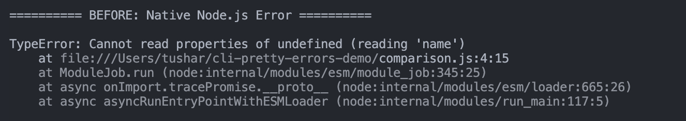
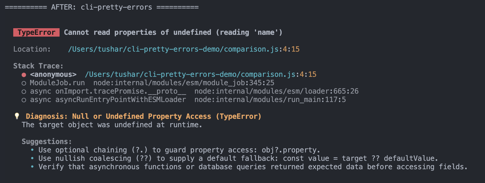

# cli-pretty-errors-demo

A demonstration project showcasing [`cli-pretty-errors`](https://www.npmjs.com/package/cli-pretty-errors), a lightweight Node.js library for readable terminal errors and deterministic troubleshooting suggestions.

## Installation

```bash
git clone https://github.com/YOUR_USERNAME/cli-pretty-errors-demo.git
cd cli-pretty-errors-demo
npm install
```

## Run the demo

```bash
npm start
```

## Demonstrations

- Native JavaScript errors (TypeError)
- Node.js system errors (ENOENT)
- Custom application errors
- Unknown thrown values
- Diagnostic explanations and troubleshooting suggestions


## Before vs After

### Native Node.js Error


### With cli-pretty-errors


## Main package

- npm: https://www.npmjs.com/package/cli-pretty-errors
- Source: https://github.com/tushaar-05/cli-pretty-errors

## License

MIT
